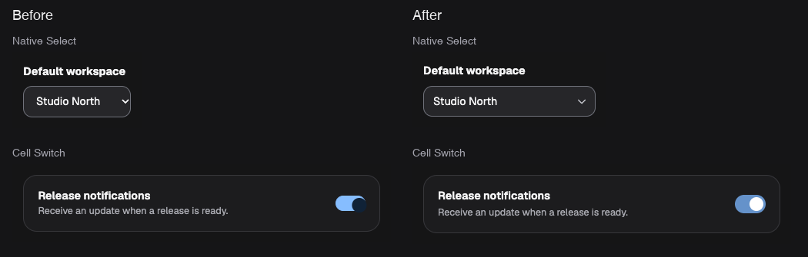

# Component spacing and alignment

Measure what the user sees. A centered SVG box can still put the painted chevron against the edge. A switch can fit its track while its thumb sticks out in the checked state.

## Shared measurements

Values below assume a 16 px root font size. Use the shared classes and tokens so the controls scale with the user's font size.

| Detail | Standard | How to check |
| --- | --- | --- |
| Fields and adjacent actions | Default minimum height 40 px. Small and large buttons use 32 and 48 px. Field content gets 12 px of inline padding. Keep 8 px between a choice and its label. | Put an input, select and submit button on one line. Their outer edges should align. Long labels can wrap in a preference row. |
| Single-line select | Reserve 36 px at the trailing edge for the 14 px indicator. The visible chevron ends about 13 px from the outside edge. | Compare short and long selections, then switch to RTL. The indicator moves to the trailing edge. Expanded and multiple selects use the platform listbox. |
| Switch | Center an 18 px thumb in a 40 × 24 px track. Leave 3 px of space around the thumb at each stop. | Toggle with a pointer and with Space in both directions. Clicking the Cell Switch label should also change the setting and show the server confirmation. |
| Icons and focus | Give standalone icon buttons a square target. Center the visible mark. Leave room for its focus outline. | Tab through each control. Check the open, pressed and selected states, including inside a narrow container. |
| Embedded examples | Size components against their container. Keep typography, link styling and form controls consistent when the code is copied into a host page. | Compare the docs preview, the standalone route and a plain host. Check a narrow viewport, larger text, both writing directions and both themes. |

## Review coverage

| Family | Components | Additional named variants |
| --- | ---: | ---: |
| Core controls and display | 77 | 4 |
| Workspace | 25 | 0 |
| Media galleries | 4 | 0 |
| Studio collections | 14 | 3 |
| Charts and conversations | 29 | 3 |
| Composition | 18 | 0 |
| **Total** | **167** | **10** |

Each component and variant received a visual review. Interactive examples were also exercised in their relevant states. The catalog run produced 344 screenshots across 360 px dark and 1280 px light. All 700 Chromium page checks passed for automated accessibility, broken label and ARIA references, overflow, HTTP errors and browser exceptions. A separate 320 px check with 125% root text found no horizontal page overflow in either writing direction. The regression suite passed 48 tests in each of Chromium, Firefox and WebKit.

To regenerate the browsable gallery, run `MERO_REVIEW_DIR=visual-review npm run audit:catalog -- --all` and open `visual-review/index.html`. The two highlighted controls also have pixel-level regression tests in the docs, standalone and plain-host examples. [Geometry tests](../test/control-geometry.test.mjs) · [Browser test setup](../README.md#verify)

Physical-device gestures, OS picker popups and a manual screen-reader pass remain open.
